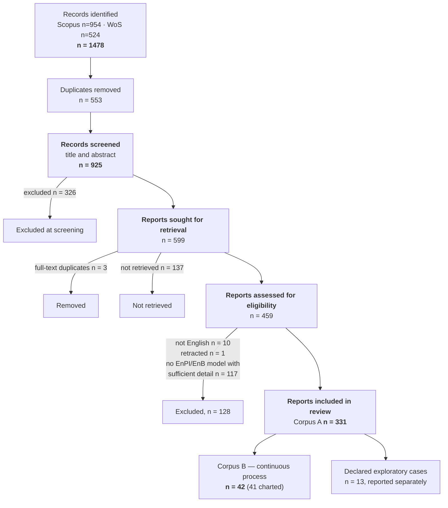

# PRISMA-ScR flow — numbers and provenance

Assembled 2026-09-16 from the frozen artefacts, not from memory. Every number below names the
file it comes from, so the diagram can be re-derived and audited.

---

## Identification

| Source | String A (normative) | String B (methodological) | Total (with overlap) |
|---|---|---|---|
| Scopus (Elsevier) | 468 | 486 | 954 |
| Web of Science Core Collection (Clarivate) | 263 | 261 | 524 |
| **Records identified** | | | **1 478** |

Search executed **February 2026** (Rayyan export date 24 February 2026), access via b-on
(NOVA). Both strings limited to `PUBYEAR > 1995` and document types article, conference paper,
review. Source: `scoping_review_protocol_v2.docx` §4.1–4.3.

Registers/grey literature: no separate register search. Grey literature from reference
organisations enters only through backward snowballing and is reported separately (§3 of the
registered protocol).

## Deduplication

| | n | Source |
|---|---|---|
| Records identified | 1 478 | protocol §4.3 |
| **Duplicates removed (Rayyan)** | **553** | derived: 1 478 − 925 |
| **Unique records screened** | **925** | `data/articles.csv`, 925 rows carrying a RAYYAN-INCLUSION label |

## Screening (title and abstract, Rayyan, single reviewer)

| | n | Source |
|---|---|---|
| Records screened | 925 | `data/articles.csv` |
| Records excluded | 326 | label `Excluded` |
| **Records sought for retrieval** | **599** | `Included` 355 + `Maybe` 244 |

> **Title and abstract were screened together, by design.** The Rayyan workflow presented
> title and abstract in the same pass, so there is no Level 1 / Level 2 split to report and none
> is missing: this is one screening step, not two collapsed into one. The registered protocol
> describes three sequential levels; the executed screening merged the first two. Report it as
> executed — *"records were screened on title and abstract together in Rayyan"* — and note the
> departure from the protocol's three-level description in the methods.

## Retrieval

| | n | Source |
|---|---|---|
| Reports sought for retrieval | 599 | above |
| Duplicates detected at full text (MD5-identical, same work, two venues) | 3 | `data/excluded_duplicates.json`; `data_quality_report.md` §2.3 |
| **Reports not retrieved** | **137** | `deterministic_gates.skipped_reason == "pdf_not_available"` over `output/stage0/` |
| **Reports retrieved** | **459** | 599 − 137 − 3; `data/pdfs/` at the 2026-07-10 freeze |

Non-retrieval is measurably non-random and is reported as a limitation with a
per-decision/DOI/sector/year missingness table: 85 % of Rayyan-Included retrieved vs 65 % of
Maybe; 92 % with DOI vs 30 % without (`VALIDATION_PROTOCOL_C.md` §9).

## Eligibility

| | n | Source |
|---|---|---|
| Reports retrieved | 459 | above |
| Excluded — language not eligible (not English) | 10 | `deterministic_gates.language_eligible == false` |
| Excluded — retracted | 1 | `deterministic_gates.not_retracted == false` |
| **Reports assessed against the eligibility criterion** | **448** | `proceeds_to_stage1 == true` |
| Excluded — does not present, propose, evaluate or critique an EnPI/EnB model with sufficient detail to identify and characterise it | **117** | 448 − 331 |
| **Reports included in the review** | **331** | Corpus A, reviewer-adjudicated; `STAGE_C_SPEC_2026-09-12.md`, matrix §3 |

## Included — and how the corpus is partitioned

| | n | Role |
|---|---|---|
| **Corpus A** — all included reports, any sector | **331** | bibliometric distribution, SQ1 |
| **Corpus B** — continuous process, §5.3 registered sector list | **42** | analytical synthesis, SQ2–SQ3 |
| of which charted at Stage C | 41 | 1 report (`rayyan-472536714`) could not be charted; documented in `stage_c/QUARANTINE_472536714_2026-09-15.md` |
| Declared exploratory cases — continuous-flow, sector off the registered list | 13 | reported separately; absent from every Corpus-B count (`CORPUS_CLOSURE_2026-09-12.md` §3.3) |

Corpus B ⊂ Corpus A. The partition is a charting variable, not an inclusion decision: sector
context alone never excluded a report.

> **Snowballing: not performed. Decision of 2026-09-16, for time.** The registered protocol
> (§16) specifies backward and forward snowballing on the included corpus with a supplementation
> trigger. It was not executed, so **S = 0 by omission, not by yield** — the distinction matters
> and must be written: a null yield would have been evidence about recall, an omission is not.
> The flow diagram carries no snowballing box. What the omission costs, measured rather than
> asserted, is in `prisma/SNOWBALLING_NOT_PERFORMED_2026-09-16.md`, and the finding there is
> reported as a limitation.

---

## Diagram

The journal requires the official PRISMA template in the main text. These are the box values.
The version below is for drafting only.

## Numbers that must reconcile

- 1 478 − 553 = 925 · 925 − 326 = 599 · 599 − 3 − 137 = 459 · 459 − 10 − 1 = 448 ·
  448 − 117 = 331 · Corpus B 42 ⊂ 331.
- No snowballing was performed, so no figure above has a supplementation delta. If that ever
  changes, this file is regenerated, not edited in place.
